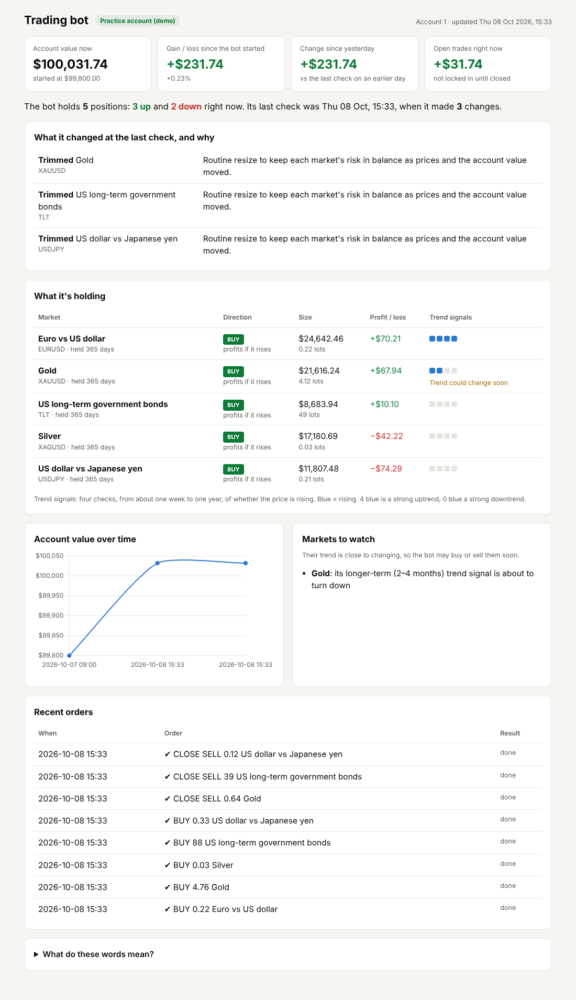
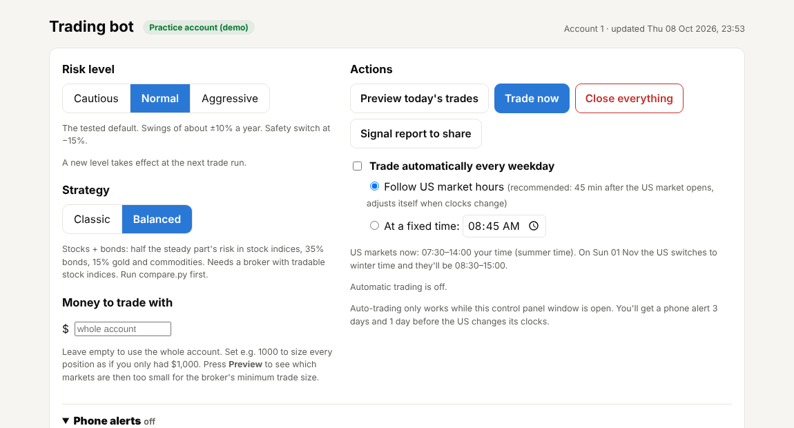
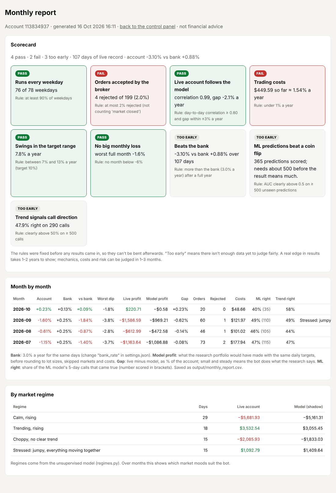

# AI Trading Bot: ML research + automated multi-asset portfolio on MetaTrader 5

A Python trading system built in two parts:

1. **A research lab** that tests a machine-learning price-direction model (gradient-boosted trees with Fibonacci features) against rule-based strategies, on unseen data, with trading costs included.
2. **A live paper-trading bot** that runs a volatility-targeted portfolio across ~40 markets (currencies, metals, stock indices, bonds, commodities) on a MetaTrader 5 demo account. It comes with a plain-English control panel, phone alerts, safety switches and a shareable signal report.

> Built as a learning project and run on a **practice (demo) account**. Not financial advice.



## What it does

| Area | Details |
|---|---|
| **Machine learning** | `HistGradientBoostingClassifier` predicting N-day price direction; walk-forward training (fit on the past, predict the next quarter, retrain), so it never scores on data it trained on. Features include returns, volatility, RSI/MACD and Fibonacci retracement levels, and the model is also run without the Fibonacci features to measure whether they help. |
| **Rule strategies** | MA crossover, EMA trend + RSI exit, MACD with trend filter, breakout with ATR trailing stop. Long-only or long/short. Parameters chosen on the first 60% of history, judged only on the last 40%. |
| **Portfolio engine** | Four trend speeds (EMA 8/32 … 64/256) vote in each market. Positions are sized by volatility so each market carries equal risk, and the whole book is scaled to a target volatility (5/10/15% a year). Blended with a long-only book, plus a **Balanced** profile with fixed risk budgets (50% stock indices, 35% bonds, 15% gold/commodities). |
| **Execution (MT5)** | Computes target positions, sends only the trades needed (10% rebalance band), pre-checks every order with the broker (`order_check`, with a fill-mode fallback), and cross-checks lot values four ways to catch broker data errors. Margin-aware scaling, and broker symbol-name matching (e.g. `GER40.cash` → DAX). |
| **Safety** | Dry run by default. Real-money accounts refused unless explicitly confirmed with the account number. Kill switch on drawdown. Broker-side crash-guard stop-losses with a 3-day re-entry wait. Per-market and total-exposure caps. Never touches manual trades. |
| **Control panel** | Local web app (`http.server`, token-protected, localhost only): risk switch, strategy switch, Preview / Trade now / Close everything, automatic daily runs that follow US market hours (including daylight-saving changes), live account numbers refreshed from MT5. |
| **Monitoring** | Dashboard explaining every position and change in plain English; real cost tracking (spread, commission, overnight swap) from MT5 deal history; equity chart; phone/email alerts via ntfy. |
| **Evaluation** | `compare.py` tests the bot's versions against the bank (T-bills), buy-and-hold S&P 500 and a 60/40 portfolio over ~20 years, including overnight financing costs. |
| **Prediction journal** | A true forward test: every day the ML model (retrained weekly, no look-ahead) and the trend signals record a 5-day prediction per market; each is scored when its outcome is known. Hit rate and AUC tracked month by month. |
| **Unsupervised regime detection** | A Gaussian mixture model groups market days by volatility, cross-market correlation and trend strength/direction, with no labels, into named regimes ("Calm, rising", "Stressed: everything moving together"…). Logs today's regime and shows how the strategy performs in each. |
| **Monthly report & scorecard** | Month-by-month return vs the bank, worst dip, costs, rejected orders, and a **shadow comparison** of live profit against what the research model should have made. A scorecard with rules fixed in advance marks each criterion PASS / FAIL / TOO EARLY. |



## How the bot is judged

Results alone can't tell skill from luck for a long time, so the bot is held to nine criteria, written down **before** any live results came in (`monthly.py`):

| Criterion | Rule | Judged after |
|---|---|---|
| Runs every weekday | ≥ 90% of weekdays | 2 weeks |
| Orders accepted | ≤ 2% rejected (excluding "market closed") | 20 orders |
| Live account follows the model | daily correlation ≥ 0.8 with the shadow model, gap within ±3% a year | 15 runs |
| Trading costs | < 1% of the account a year | 30 days |
| Swings in range | realised volatility within 70–130% of target | 60 days |
| No big monthly loss | no month below −6% | first full month |
| Beats the bank | more than T-bill-like interest after costs | 1 year |
| ML predictions | AUC clearly above 0.5 on ≥ 500 unseen predictions | ~4 months |
| Trend-signal calls | hit rate clearly above 50% on ≥ 500 calls | ~4 months |



## Honest results

Everything was tested out-of-sample with costs included. Most of the work went into **finding out what doesn't work**:

| Test | Result |
|---|---|
| ML model (EURUSD daily, 2019–2026) | AUC **0.499**: no better than a coin flip |
| Fibonacci features | No measurable effect (AUC 0.499 with vs 0.492 without) |
| 4 rule strategies × 8 markets | None positive on more than 4 of 8 markets; median Sharpe ≤ 0.03 |
| Gold MA crossover | Sharpe 0.82 vs buy-and-hold 0.95: the gains came from gold's bull run, not the strategy |
| Trend portfolio, 37 markets, 2007–2026 | Sharpe 0.13, but **+26% in 2008** when long-only lost 4% |
| 25% trend / 75% long-only blend | Sharpe 0.32, max drawdown −25.8%, the most robust combination tested |

**Takeaway:** price prediction showed no tradeable edge. The bot is designed around diversification, risk control and low costs rather than forecasting. The live demo exists to validate the mechanics (sizing, costs, broker behaviour), which is where most real-world bugs were found and fixed.

## Things I learned building it

- **Broker data can't be trusted blindly.** The demo reported platinum's lot value 80× too small. The 4-way lot-value cross-check and margin check now catch this.
- **Leakage is easy.** Every signal uses only completed bars and is applied to the *next* bar; the ML model uses walk-forward retraining.
- **Costs decide everything at low returns.** Overnight financing on leveraged CFDs can be larger than the strategy's expected edge, so it's modelled explicitly.
- **Make it usable for a non-programmer:** plain-English explanations, one-click actions, and safety defaults that make a real-money mistake hard.

## Tech stack

Python · pandas · NumPy · scikit-learn · MetaTrader5 API · yfinance · Chart.js · vanilla HTML/JS · ntfy (alerts)

## Quick start

```bash
pip install -r requirements.txt
python run.py --simulate          # research report on simulated data (no accounts needed)
python run.py --ticker SPY        # research report on real data from Yahoo Finance
python compare.py                 # bot versions vs bank / S&P 500 / 60-40 (Yahoo data)
python regimes.py --yahoo         # unsupervised market regimes + strategy performance per regime
```

With MetaTrader 5 on Windows (demo account): see [SETUP_MT5.md](SETUP_MT5.md), then

```bash
python execute.py                 # dry run: shows today's trades, sends nothing
python app.py                     # control panel in the browser
```

More: [docs/USAGE.md](docs/USAGE.md) (all scripts and options) · [PAPER_TRADING.md](PAPER_TRADING.md) (running the demo safely) · [BALANCED_SETUP.md](BALANCED_SETUP.md) (stocks + bonds profile).

## Project structure

```
data.py          price data: Yahoo, MetaTrader 5, CSV, simulated
indicators.py    SMA, EMA, RSI, MACD, ATR, Bollinger
strategies.py    rule-based strategies
ml_model.py      features (incl. Fibonacci) + walk-forward gradient boosting
backtest.py      next-bar execution, costs, statistics
run.py / scan.py single-market research report / multi-market scan
portfolio.py     volatility-targeted trend + long-only portfolio, strategy profiles
compare.py       strategy vs benchmarks, with financing costs
predictions.py   prediction journal: daily ML + trend predictions, scored 5 days later
regimes.py       unsupervised market-regime detection (Gaussian mixture)
monthly.py       monthly report, shadow model comparison and pass/fail scorecard
execute.py       MT5 execution engine with safety checks
symbols.py       broker symbol-name matching
app.py           local control panel and scheduler
dashboard.py     plain-English dashboard
signals.py       shareable signal report
alerts.py        phone/email alerts (ntfy)
markettime.py    US market hours and daylight-saving logic
```

## Disclaimer

For education and research. Trading leveraged products carries a high risk of loss. Past or backtested performance does not predict future results.
